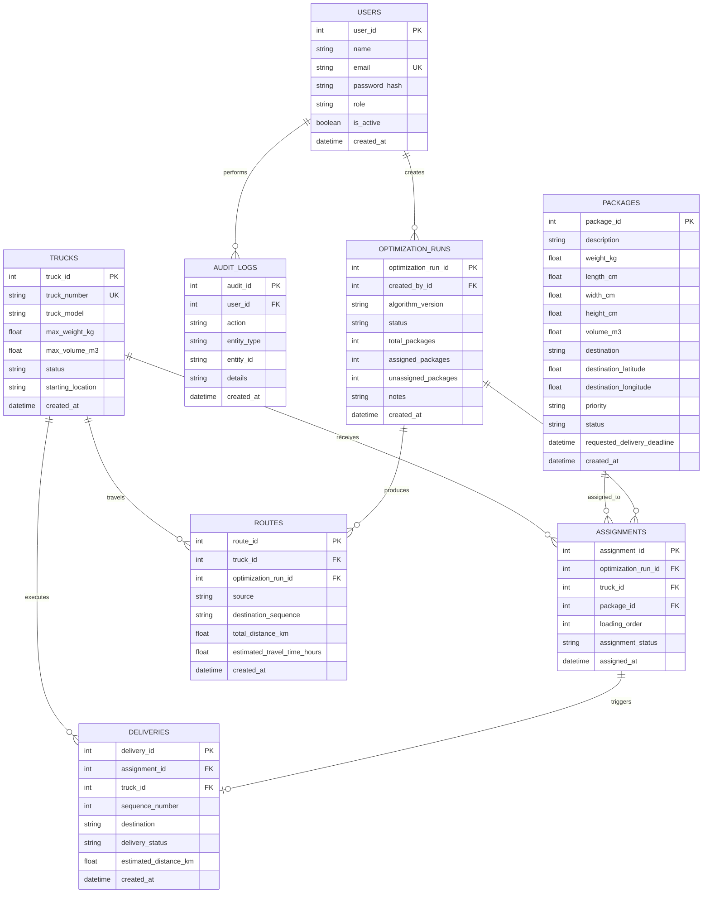

# Database Design & RDBMS Specification

## 1. Relational Database Overview & DP-900 Alignment
LoadOpt demonstrates modern Relational Database Management System (RDBMS) design, structured in compliance with **Microsoft Azure DP-900 (Azure Data Fundamentals)** concepts:
- **Normalization (3NF)**: Redundant operational data is eliminated while ensuring referential integrity across fleets, consignments, and dispatch schedules.
- **ACID Transaction Guarantees**: Optimization runs, simulation plan applications, and status updates are managed with explicit commit and rollback boundaries.
- **Portability**: Database access is abstracted via SQLAlchemy 2.0 ORM, enabling execution against SQLite in development and Microsoft Azure SQL Database in cloud production.
- **Analytical Reporting**: Supported via relational SQL Views (`v_truck_utilization`) ready for direct ingestion by **Power BI** or Azure Synapse.

---

## 2. Entity-Relationship (ER) Diagram



---

## 3. Relational Table Specifications

### 1. `users`
| Column | Type | Constraints | Description |
|---|---|---|---|
| `user_id` | Integer | PK, Auto-increment | Surrogate primary key |
| `name` | String(100) | NOT NULL | User's full display name |
| `email` | String(120) | UNIQUE, NOT NULL, INDEX | Login identifier |
| `password_hash`| String(255) | NOT NULL | Salted BCrypt password hash |
| `role` | String(30) | NOT NULL | `ADMIN`, `LOGISTICS_MANAGER`, or `VIEWER` |
| `is_active` | Boolean | DEFAULT True | Account status toggle |
| `created_at` | DateTime | NOT NULL | Account creation timestamp |

### 2. `trucks`
| Column | Type | Constraints | Description |
|---|---|---|---|
| `truck_id` | Integer | PK, Auto-increment | Unique identifier |
| `truck_number` | String(50) | UNIQUE, NOT NULL, INDEX | License registration or fleet code |
| `truck_model` | String(100) | NOT NULL | Make & model description |
| `max_weight_kg`| Float | CHECK (> 0), NOT NULL | Maximum gross payload capacity in kilograms |
| `max_volume_m3`| Float | CHECK (> 0), NOT NULL | Maximum internal storage volume in cubic meters |
| `status` | String(30) | NOT NULL, DEFAULT 'AVAILABLE' | `AVAILABLE`, `IN_TRANSIT`, `MAINTENANCE`, `OUT_OF_SERVICE` |
| `starting_location` | String(150) | NOT NULL | Origin hub for route planning |
| `created_at` | DateTime | NOT NULL | Registration date |

### 3. `packages`
| Column | Type | Constraints | Description |
|---|---|---|---|
| `package_id` | Integer | PK, Auto-increment | Unique package tracking ID |
| `description` | String(200) | NOT NULL | Consignment description |
| `weight_kg` | Float | CHECK (> 0), NOT NULL | Package mass in kg |
| `length_cm` | Float | CHECK (> 0), NOT NULL | Length in centimeters |
| `width_cm` | Float | CHECK (> 0), NOT NULL | Width in centimeters |
| `height_cm` | Float | CHECK (> 0), NOT NULL | Height in centimeters |
| `volume_m3` | Float | CHECK (> 0), NOT NULL | Computed volume: `(L × W × H) / 1,000,000` |
| `destination` | String(150) | NOT NULL | Delivery address / city |
| `destination_latitude` | Float | NULLABLE | Latitude GPS coordinate |
| `destination_longitude`| Float | NULLABLE | Longitude GPS coordinate |
| `priority` | String(20) | NOT NULL, DEFAULT 'MEDIUM' | `HIGH`, `MEDIUM`, `LOW` |
| `status` | String(30) | NOT NULL, DEFAULT 'PENDING' | `PENDING`, `ASSIGNED`, `IN_TRANSIT`, `DELIVERED`, `CANCELLED` |
| `requested_delivery_deadline` | DateTime | NULLABLE | Optional customer deadline |
| `created_at` | DateTime | NOT NULL | Ingestion timestamp |

### 4. `optimization_runs`
Tracks historical algorithm executions for auditing and comparison.

### 5. `assignments`
Connects packages to specific trucks. Enforces assignment state: `ACTIVE`, `HISTORICAL`, or `CANCELLED`. Only `ACTIVE` assignments consume vehicle capacity.

### 6. `deliveries` & `routes`
Stores ordered route waypoints, leg distances, and stop numbers calculated by the Nearest-Neighbor delivery sequencer.

---

## 4. SQL View: `v_truck_utilization`
To support fast analytical querying without executing heavy application-side joins on every request, the database implements the following view:

```sql
CREATE VIEW v_truck_utilization AS
SELECT 
    t.truck_id,
    t.truck_number,
    t.truck_model,
    t.status,
    t.max_weight_kg,
    t.max_volume_m3,
    COALESCE(SUM(p.weight_kg), 0.0) AS total_assigned_weight_kg,
    COALESCE(SUM(p.volume_m3), 0.0) AS total_assigned_volume_m3,
    ROUND(CASE WHEN t.max_weight_kg > 0 THEN (COALESCE(SUM(p.weight_kg), 0.0) / t.max_weight_kg) * 100.0 ELSE 0.0 END, 2) AS weight_utilization_pct,
    ROUND(CASE WHEN t.max_volume_m3 > 0 THEN (COALESCE(SUM(p.volume_m3), 0.0) / t.max_volume_m3) * 100.0 ELSE 0.0 END, 2) AS volume_utilization_pct,
    COUNT(a.assignment_id) AS assigned_package_count
FROM trucks t
LEFT JOIN assignments a ON t.truck_id = a.truck_id AND a.assignment_status = 'ACTIVE'
LEFT JOIN packages p ON a.package_id = p.package_id
GROUP BY t.truck_id, t.truck_number, t.truck_model, t.status, t.max_weight_kg, t.max_volume_m3;
```
